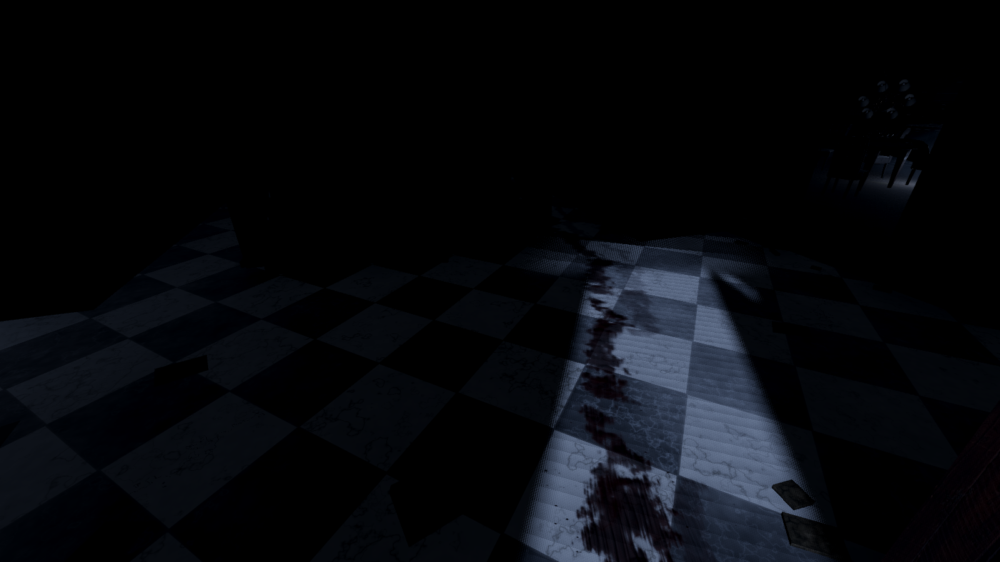
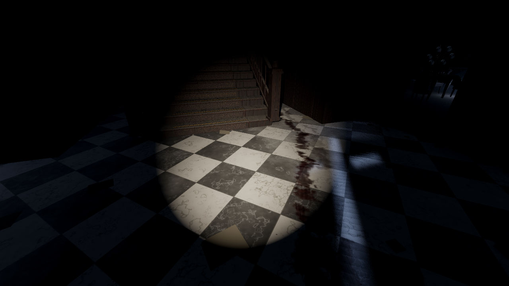
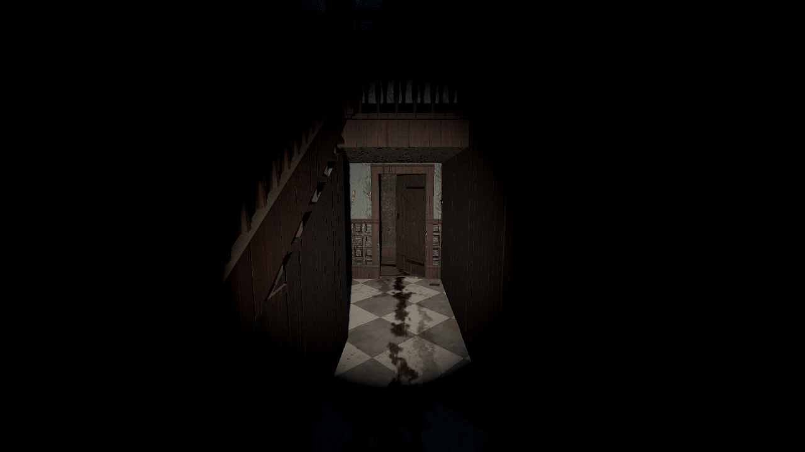
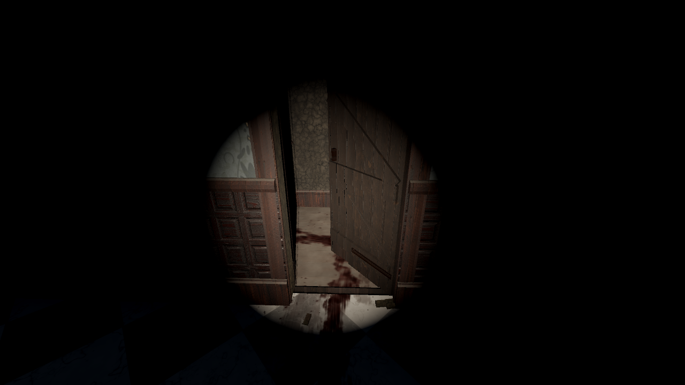
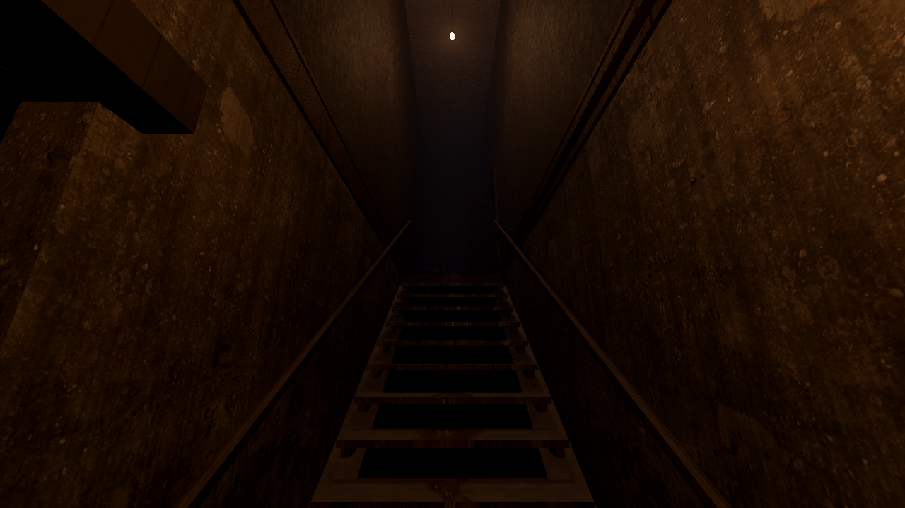
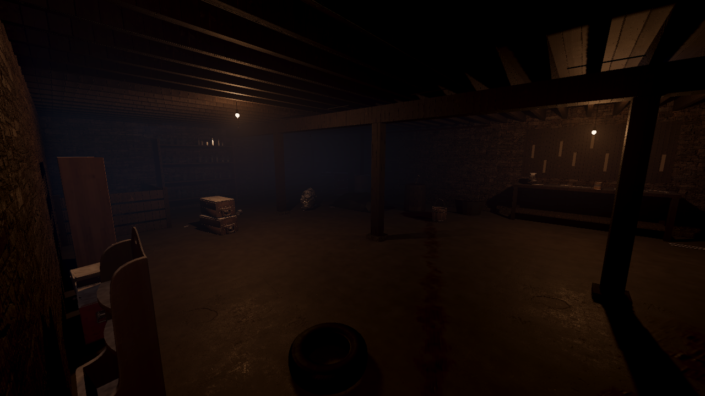
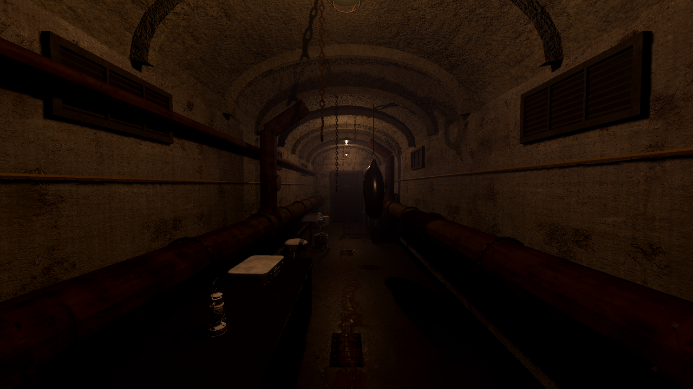
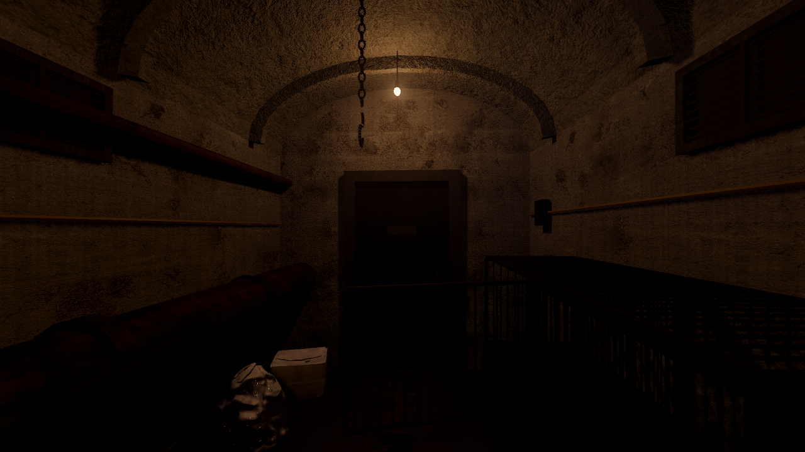
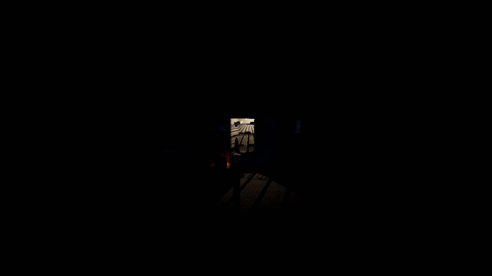

# The Nichols basement: Windows 0.22.0

Updated 2026-10-09. The owner asked for:

- the out-of-place objects in the Nichols house fixed (their screenshot: a picture frame floating in a doorway);
- almost every object inside the house to be physical, so it can be picked up or moved;
- obvious clues leading to a door to the basement, with stairs going down;
- deep in the basement, an eerie secret entrance, using their corridor reference (3rd image) for the mood;
- very little light: dim bulbs, some flickering at random, switched on at a switch beside the basement door;
- the basement door half open, so the player can push or pull it;
- drag trails of blood a few days old (animal bodies) leading from the entrance to the basement door;
- the first time the player sees the trail: "Shit..", "I thought this place was empty decades ago?";
- fine detail and textures, rooms designed like a professional set (their 2nd and 4th images for mood);
- very creepy, dark, intense and full of dread;
- the EXE built, and screenshots sent at every step.

During the run the owner added three things:

- **Downloads allowed.** They were free to download models and textures.
- **No corny blood.** The first blood lettering was "corny"; trails and splatter only, and "add your twist" rather than copying the reference. The lettering and the hand print were removed, and the corridor became our own wartime tunnel.
- **Keep the fridge on.** They asked why a fridge would glow in a house empty for decades, accepted that it is a clue (someone tapped power and lives here), and asked to keep it on. A visible jumper cable now explains it.

## What changed

### Out-of-place objects (`nichols_property.gd`)

- **The floating frame (the owner's screenshot).** `hanging_picture_frame_02` hung in mid-air inside the parlour doorway. Its back face is culled, so it was invisible from the hall but floated in front of the dark door leaf from the parlour. It now hangs on the hall wall.
- **Moved off openings and windows:**
  - the console that stood across the dining room's open pocket doorway (now in the rear hall, with its vase and horse);
  - two library bookcases covering windows (bookcases now line the solid east wall);
  - the master bedroom wardrobe in front of a window;
  - the nursery cot under a window.
- **Overlaps fixed:**
  - the piano pushed 0.36 m through the parlour wall into the hall;
  - the candleholders sat inside a 2.24 m cabinet (now on the commode);
  - a vase overlapped a candelabra on the mantel;
  - the master bed and the upstairs console overlapped their walls;
  - the gothic cabinet faced the wall;
  - the tea set hung off the table edge;
  - the dining chairs intersected the table.
- **Black squares on every floor.** The scattered papers rendered black. The builder's `_quad` has a fixed winding, so the up-facing sheet was a back face with its normal flipped down. They now use one correctly wound face.
- **Never-aged furniture.** Glossy scans import as `ORMMaterial3D`, which the 0.21 aging pass skipped; it was too bright and clean (the white dining cabinet, for one). The pass now handles every `BaseMaterial3D`.

### Physics for nearly everything (`_physical`, 123 props)

- **Every furniture model, sheet and prop in the house is an `InteriorObject`.** It has a box fitted to the model's own bounds:
  - things under 15 kg are carried with E;
  - heavier furniture is dragged with hold-E or shoved;
  - frames and mirrors hang frozen until grabbed.
- **Seat colliders.** Chairs, the cot, the bed and the wheelchair get a seat-height base plus boxes for the backs and head and foot boards, computed from the mesh, so dolls sit on them.
- **Dust sheets** collide at 68% of their drape.
- **Static by design:** the hanging chandelier, the one fallen on the table, the bench vice and the hatchet in the block.
- **Impact sounds** reach every prop through the neighbourhood's `loose_prop` wiring.
- **All props settle at load:** none moves more than 0.2 m (checked).

### The trail and the first look (`nichols_basement.gd`)

- **The trail itself.** A drag trail runs from just inside the front door, through the moonlight that falls through the open door (so it shows without the flashlight), round the grand stair and down the east nook under its landing. It continues to the cellar door, down the stair, across the cellar, behind the dragged shelf and along the tunnel to the iron door.
- **How it's made:**
  - 128 decals in all;
  - three dried drag-smear textures with fur streaks and lift-off gaps;
  - an older, fainter trail beside the main one ("this was not the first");
  - drops, pools where bodies were set down, and splatter here and there (the chopping-block wall, the bench, a cage floor, the sink, the kitchen);
  - a second branch to the butcher's corner.
- **Textures:** generated by `tools/assets/make_blood_decals.py`. Dried maroon-brown, near black and tacky where thick.
- **The first look.** It fires when the trail is in the view centre within 9 m with nothing in between: "Shit..", then "I thought this place was empty decades ago?" (once).

### The cellar door and the switch

- **Placement.** A low ledged plank door with iron straps, under the grand stair's landing at the end of the east nook. It is left half open (48 degrees), pushed or pulled like every Nichols door, with the old hinge squeals.
- **The switch.** Beside it, on the nook panel: an old round brass plate with a bakelite toggle and a conduit up to the landing. It reads "Turn on the light" / "Turn off the light" and clicks.
- **The bulbs:**
  - eight in all, seven working: over the stair shaft, at its foot, two in the cellar (a third is dead) and three in the tunnel;
  - they come on one after another with a stutter;
  - four flicker at random and the worst ones arc and buzz;
  - each hums (60 Hz) while lit;
  - weak pools of warm light with a faint cool bounce once on; the dark between them stays dark.

### Below the boards (`tools/blender/nichols/nichols_basement.py`, `house_base.glb`, visual layer `1 << 12`)

- **Stair shaft.** The old closet behind the foyer is the shaft. An open-riser wooden stair drops 2.7 m (14 risers), with handrails on iron brackets, over junk under the stair.
- **The 1906 fieldstone cellar:**
  - joists and subfloor overhead, a girder on three posts;
  - a coal bin, plank shelves of preserve jars gone dark;
  - a workbench with a pegboard of tool outlines, some tools missing, a saw, a machete;
  - a butcher's corner: a drain, a chopping block with a hatchet in it, a rail of S-hooks and chains, a galvanised tub, a tarp over something the flies found;
  - barrels, an iron stove with its flue, racks, crates, a tyre, a ladder, a gas tank, a dead rat.
- **The hole.** Broken through the east wall, rubble on the floor, a sledgehammer against the wall, a crowbar. The shelf that hid it has been dragged a metre aside, with scrape marks in the dust.
- **The tunnel (our own take on the owner's 3rd reference).** Davao still has the tunnels of the Japanese occupation; this one runs under the house:
  - a barrel-vaulted concrete tunnel with ribs, its mouth shored with timber;
  - rusted mains on brackets with flanged joints, risers, a valve, a yellow conduit;
  - louvred vents;
  - a metal desk (a lantern, a first-aid box);
  - a stack of dog cages where the reference had lockers: two doors open, bowls, a collar;
  - chains and meat hooks from the crown;
  - a lumpy wrapped sack hanging by the wall, blood run down its plastic;
  - a stained sink;
  - a rusted iron door chained shut with one new padlock: "Chained shut." / "That padlock is new." / "Someone comes down here."
- **No lettering.** No blood writing and no hand prints (the owner: "no corny stuff").
- **The ground.** The town's ground slab (collider and mesh) and the estate ground mesh are cut out inside the house's outer walls, so no grass plane crosses the shaft or the cellar. The canal's exact mesh-clipping code was reused through an optional rectangle argument.
- **Lighting and sound underground:**
  - the basement layer is masked off every directional light (no moon, no room key);
  - the reflection probes are near black and re-capture when the switch is thrown;
  - faint dust for the bulbs' halos; damp floors with a sheen;
  - footsteps on concrete, a stone-cellar room tone, drips, flies;
  - the night outside is muffled to a rumble (`night_audio.gd`).

### The kitchen (after the owner's 4th image, our own dressing)

- **Fittings:**
  - an enamel farmhouse sink with ribbed drainboards on a painted cabinet, under the south window (its sill raised to 1.15 m), bloody plates stacked in the drainer;
  - a chipped enamel range with an enamel pot and a pan;
  - open shelves of jars and tins and a utensil rail;
  - a scarred work table with a board, a knife, a bowl and a jug.
- **The rounded 1950s refrigerator.** It stands open with its bulb lit and its compressor humming, wire-shelf shadows thrown across the floor, dark meat inside.
- **Why it runs (owner-approved).** A new orange extension cable comes in through a broken pane of the east window, down the wall, behind the fridge, to a cheap power strip on the floor whose rocker glows orange. Outside the cable droops from the window into the weeds.

### Debug menu and captures

- **New teleports:** "Cellar door", "Cellar" and "Tunnel", plus a "Cellar lights" toggle.
- **EXE capture:** `Interior.exe -- --capture-review --capture-views=basement --capture-path=<dir>`.

## Verification

- **`tests/basement_integration.gd`: 57/57 headless.** A real player:
  - stands inside the front door facing out (no line), then looks at the trail and gets both lines in order;
  - follows it round the stair into the nook;
  - finds the cellar door half open, pushes it wide, and aims at the switch from the nook;
  - turns it on (7 of 7 bulbs), goes down the stair (foot at -2.67 m), across the cellar, through the hole, down the steps and along the tunnel to the iron door ("Chained shut.").
- **It also checks:**
  - no town ground box inside the walls;
  - floor heights (landing, shaft, cellar, tunnel; the ground beside and behind the house unchanged);
  - 123 props settling with none moved, frames hanging;
  - the crowbar carried up to chest height;
  - concrete footsteps;
  - a failing bulb dipping;
  - switch off leaving zero lit;
  - the fridge light, and the jumper in the layout.
- **Regressions** (all pass; the balcony test's layer invariant now includes the basement layer):

  | Test | Result |
  |---|---|
  | nichols | 46/46 |
  | debug menu | 36/36 |
  | canal | 57/57 |
  | warren | 87/87 |
  | balcony | 63/63 |
  | street | 27/27 |
  | gun | 41/41 |
  | hut story | 74/74 |
  | stranger | 26/26 |
  | fields | 25/25 |
  | touch (`-- --mobile-test`) | 29/29 |
  | neighbourhood interactions | 29/29 |
  | night revision | 28/28 |

  Nichols, balcony, debug menu and basement were rerun on the final files.
- **Rendered review:** `tests/basement_review.gd` (Forward+ High, 1600x900, RTX 4060).
  - Every trail and basement view held 60 FPS with vsync on.
  - The busiest, looking east across the cellar, draws about 3,700 calls and about 11 M primitives.
- **Exported EXE:** `builds/windows/Interior.exe` 0.22.0, 1,364,573,664 bytes, SHA-256 `51faca6288cb54737c57a86f2b271636272b8dc2441af6817d00f54ef5ba3c11`.
  - Its own `--capture-views=basement` produced the `basement-*.png` frames here with no script errors.
  - It reported 8 bulbs (7 lights), 128 decals, 47 basement and kitchen props, and the ground cut once.

## Independent review (lemondev)

A fresh reviewer each time saw only the owner's references (2nd, 3rd and 4th images) and our frames under random labels, with a forced choice per pair.

- **Pass 1:** the references won 3 of 3. The largest gap: the lighting crushed floors and lower frames to black, so the spaces read as voids. Also flagged: vents read as placeholder slabs, the hanging bundle read as a tank, and the power strip glow was a hard circle.
  - Fixes: bulbs that reach the floor with a softer falloff, a faint cool bounce when lit, damp glossy floors, and probes re-capturing at the switch. Also louvred vents, a lumpy tied sack and a softer strip glow.
- **Pass 2:** the references won 3 of 3 again, with the same primary gap (light shaping: murky floors and corners, no distinct pools or warm and cool contrast).
- **State: STOPPED — PLATEAU** by the skill's two-identical-gaps rule.
  - Part of the gap is the owner's brief (very little light from dim bulbs) set against brighter showcase art.
  - Part is real: the pools could be shaped more, for example with a visible cone under each bulb or a cool spill from the shaft.
- **After the stop (not re-reviewed):** the sack moved off the walking line, blood streaks on its plastic, the fridge's enamel aged.

## Known gaps

- The EXE grew from 1.21 GB to 1.36 GB. Three 2K basement textures (cellar floor, stone, tunnel concrete) account for most of it; 1K would recover most of that.
- Decals are Forward+/Mobile only. The Android APK was not rebuilt (as in 0.21); Compatibility would show no blood.
- The iron door is locked for now ("later").
- The kitchen jug and a few small scans still look a little clean under the flashlight.
- The flashlight's hard-edged circle (0.19) was flagged by the reviewer; it is out of this scope.
- The tunnel vents still read as plain slabs at a distance.

## Screenshots sent

| File | What |
|---|---|
| `progress-1-fixes.jpg` | The floating frame gone, consoles, bookcases and wardrobe off openings and windows, papers no longer black |
| `progress-2-blender.jpg` | Clay renders: the nook door, the stair shaft, the cellar, the hole, the corridor, the plan |
| `progress-3-ingame.jpg` | In game: the trail, the nook, the cellar door, the stair, the cellar, the tunnel, the iron door, the kitchen with the fridge on |
| `progress-4-exe.jpg` | From the exported EXE, plus the entry by moonlight only |
| `progress-5-final.jpg` | Final build: trail by moonlight, nook, cellar door, stair, cellar, tunnel, iron door, kitchen jumper |
| `basement-*.png` | The EXE's own captures of the final build |

  
  
  

Rebuild everything:

```text
python tools/assets/fetch_basement.py
python tools/assets/make_blood_decals.py
python tools/assets/make_basement_sounds.py
"C:/Program Files/Blender Foundation/Blender 5.2/blender.exe" -b --factory-startup -P tools/blender/process_downloads.py -- nh_worn_metal_rack nh_... (entries "0.22 Nichols basement")
"C:/Program Files/Blender Foundation/Blender 5.2/blender.exe" -b --factory-startup -P tools/blender/nichols/build_nichols.py [-- --preview <dir>]
Godot_v4.7.2-stable_win64_console.exe --headless --path game --import
Godot_v4.7.2-stable_win64_console.exe --headless --fixed-fps 60 --path game --script res://tests/basement_integration.gd
Godot_v4.7.2-stable_win64_console.exe --path game --script res://tests/basement_review.gd -- [--work-light] [--torch] [--lights-on] [--front-open]
Godot_v4.7.2-stable_win64_console.exe --headless --path game --export-release "Windows Desktop" <abs>/builds/windows/Interior.exe
Interior.exe -- --capture-review --capture-views=basement --capture-path=<dir>
```
