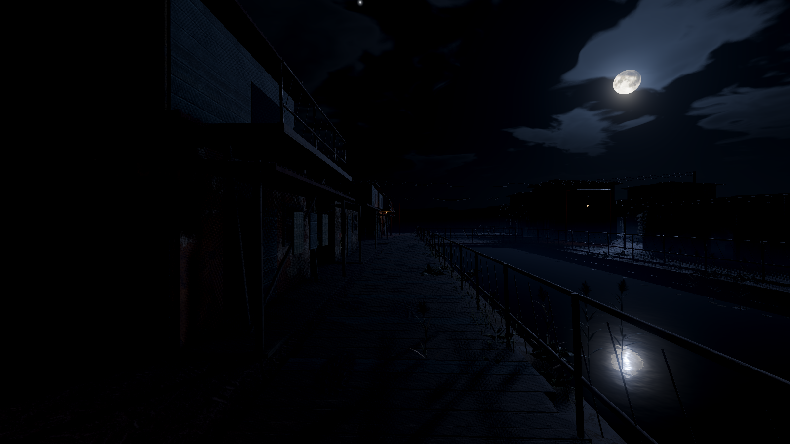
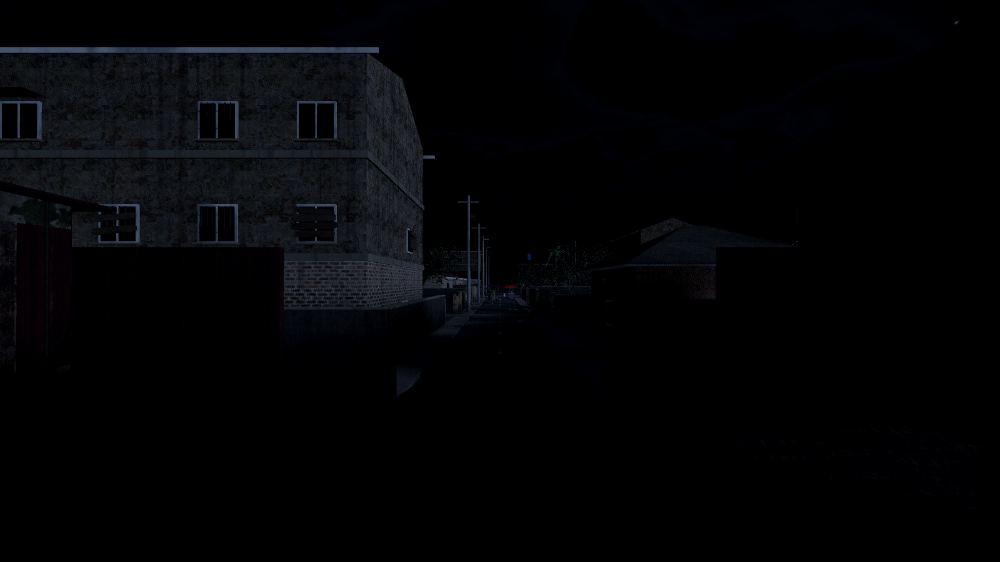
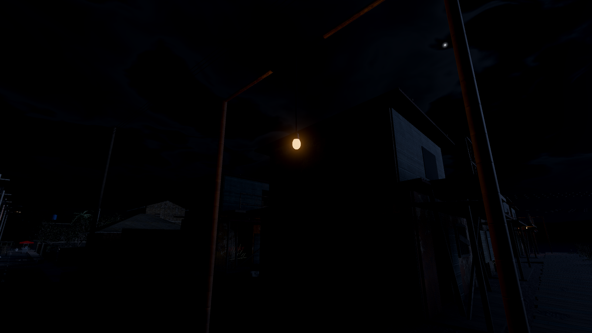

# Darkness correction — Windows 0.16.1

Removed the canal's camera-position-based boost to the shared WorldEnvironment. That boost raised ambient energy from 0.24 to 0.68 and brightened its color, affecting the old neighborhood as well as the canal. The original dark town ambient is restored, with the existing sparse local bulbs and moonlight.

The user's direction is intentional darkness: gloomy, scary environments with deep shadows and few light sources. Do not raise the global ambient to expose materials or make screenshots brighter.

Rendered regression: 20 checks passed across five positions, moving from the original street into the canal and back. Ambient energy, color, source and exposure remain consistent. Evidence is in `lighting.json` and the three screenshots. The main Windows executable was replaced with version 0.16.1.

