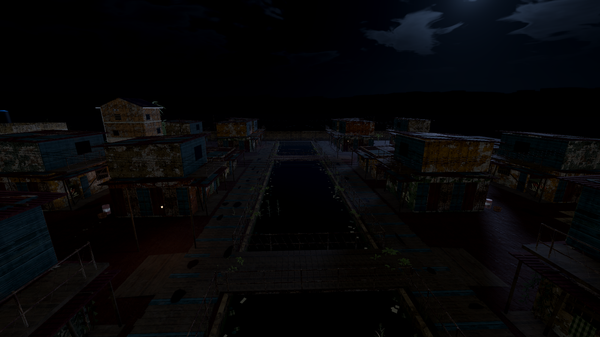
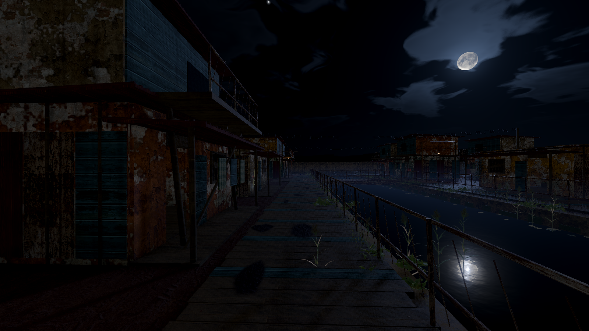
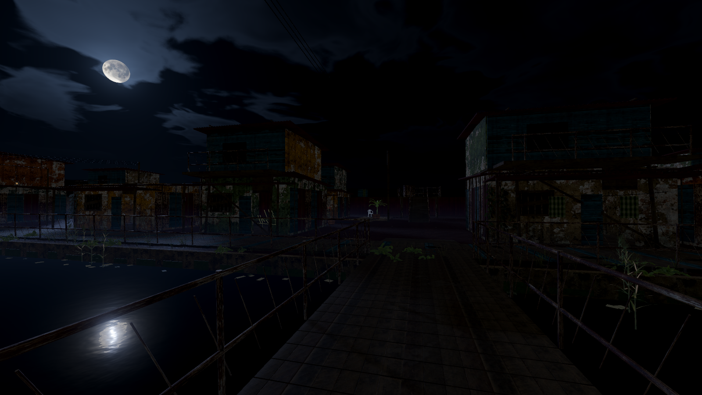
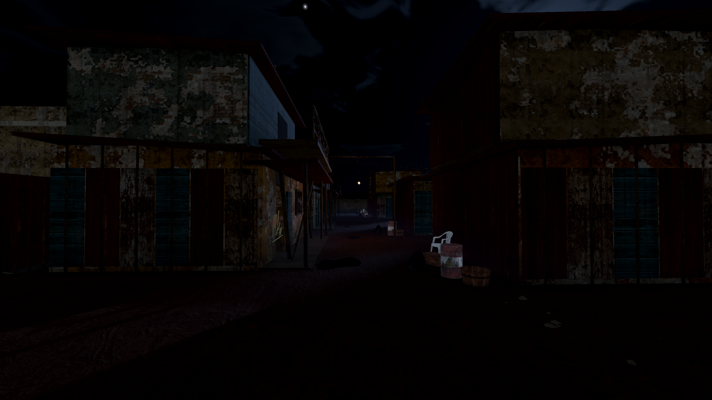
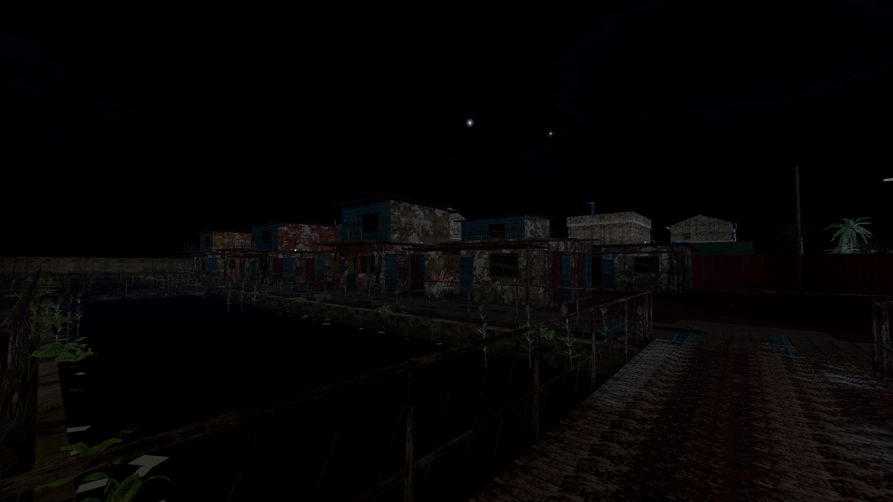
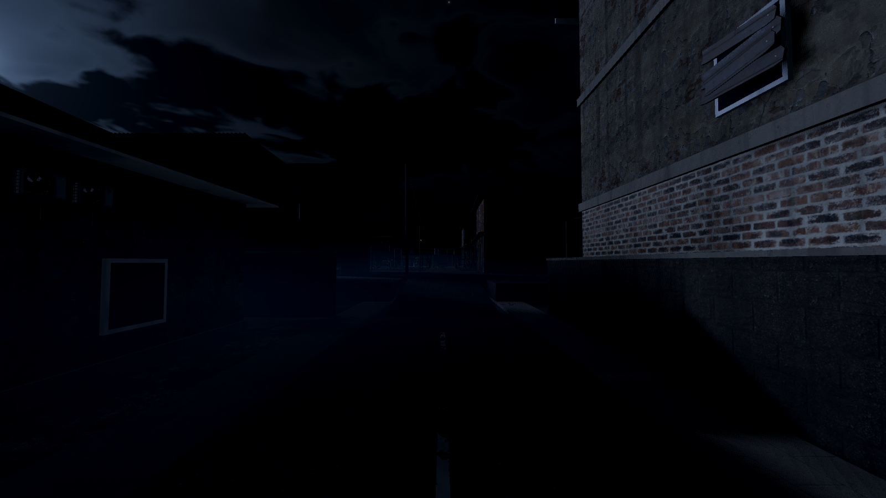
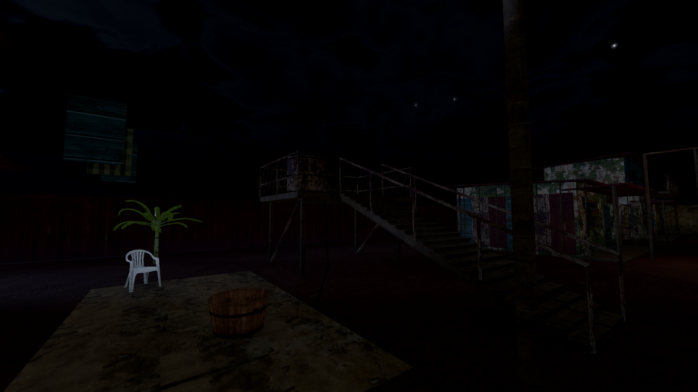
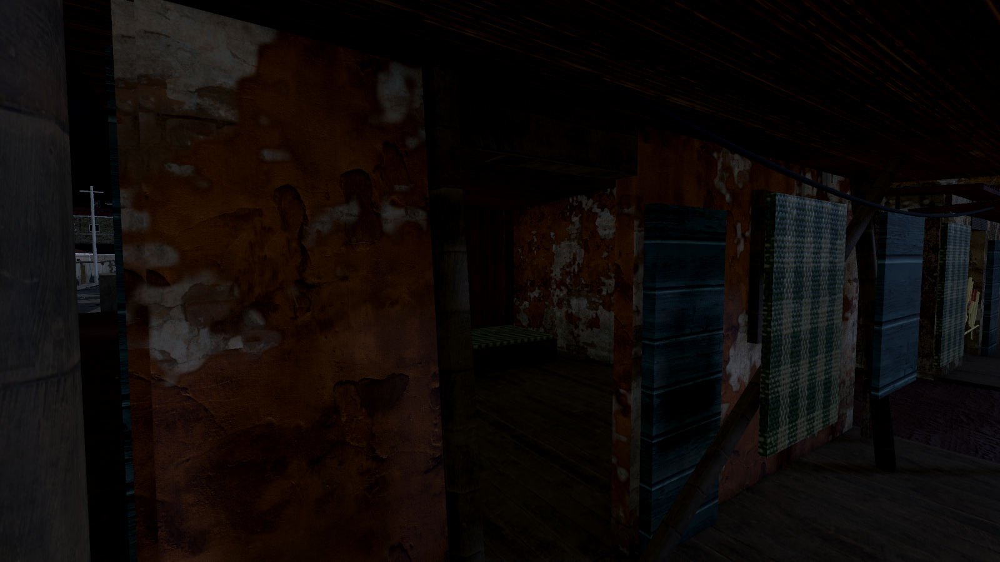
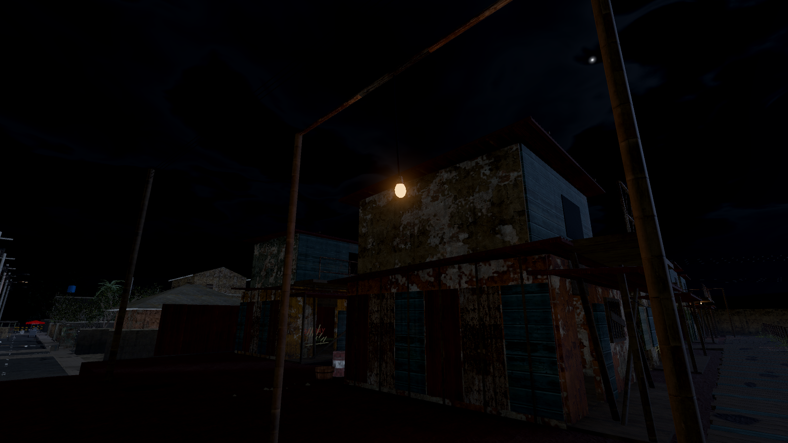

# Canal settlement — Windows 0.16

The new district is west of the player's house. Leave the courtyard, follow the lane to the north–south street, then turn left along the main cross street. Continue past the old western barricade location and up the dirt approach to the wooden crossing.

## Area

- Approximately 59 × 78 metres, with 24 patchwork houses and 16 upper additions.
- Two continuous timber waterfront promenades, a timber crossing and a rusted metal crossing, dirt back lanes, open ground-floor rooms, and an accessible raised water-storage platform with stairs.
- 490 individual promenade planks, nail heads, framing, sheet-metal ridges and repairs, cross braces, window bars, overhangs, drainage pipes, sagging cables, laundry, discarded containers and street debris.
- A murky rippling canal with retaining walls, tide stains, bank ferns, reeds, bananas, trees, climbing vines and wind-driven grass. Walkable recovery ramps at both canal ends prevent a player who jumps a railing becoming trapped.
- Five suspended bare bulbs. Four have independently phased flicker/outages; all swing with a changing breeze and respond to the existing wind gusts. Actual sockets and timber/steel supports connect the fixtures to the environment.
- Photographic rust, wood, mud, cloth and plaster maps reuse the game's material language. The existing weathering shader supplies peeling surfaces, damp and runoff. Original worn graffiti decals and mud/puddle details are added locally.
- 99 placed model instances, including newly downloaded CC0 trashbags and crates and the project's already credited props and plants. See [asset credits](../../game/licenses/CANAL.md).

## Verification

All 167 checks passed:

| Check | Result |
| --- | --- |
| `canal_integration.gd` | 44 passed: real-player route from the house street through both crossings and back, platform stairs, dirt side lane, three shack entrances, both water recovery routes, ray-resolved surface sounds, actual footstep signals, bulb movement/flicker, and hiding the exterior on returning home |
| `neighborhood_interactions.gd` | 29 passed: 36 physical gates, 21 house entrances and existing interactions |
| `neighborhood_decay_integration.gd` | 32 passed: neighborhood geometry, normals/winding and existing walking route |
| `balcony_integration.gd` | 62 passed: original house door, balcony/stairs, courtyard, props and lighting isolation |

The rendered review loads all five variants of each wood/dirt/metal audio set. `render.json` records nine review views at High, 1600×900, Forward+, on the available RTX 4060. The final nine-view measurements were approximately 60 FPS with display synchronization; they are observations on this machine, not measurements of other hardware.

`integration.json`, the regression logs, `render.json`, and the exported-build smoke log provide the detailed evidence. Windows export targets the main `builds/windows/Interior.exe` with an embedded PCK.

The final Windows executable reports version 0.16.0 and is 656,440,656 bytes. It was launched with Forward+ at High, 1600×900, autoplay for 360 frames; it exited with code 0 and no missing-resource or script errors. `build.json` records its SHA-256 digest.

## Screenshots

## Source organization

`game/scripts/canal_settlement.gd` owns the deterministic district and its runtime bulbs. The baked room and its furnishings are preserved. The old western street barricade is removed from its shared render batches and its collision opening is changed at runtime. Raised exterior positions are recognized by the balcony, environmental grade and night audio.

Collision shapes carry `surface` metadata, so the player's normal ground ray chooses dirt, wood, metal or concrete. Metal uses a damped metallic footfall mix; dirt uses a filtered earthy footfall, with five non-repeating source variations for each. Reproduction scripts and downloaded asset checksums are retained under `tools/assets/` and `game/assets/models/canal/`.
