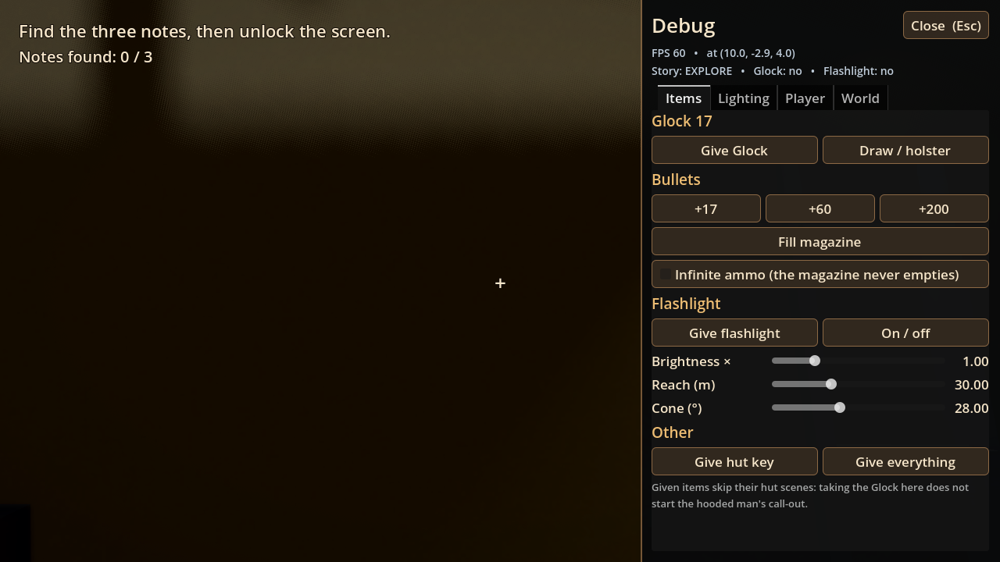
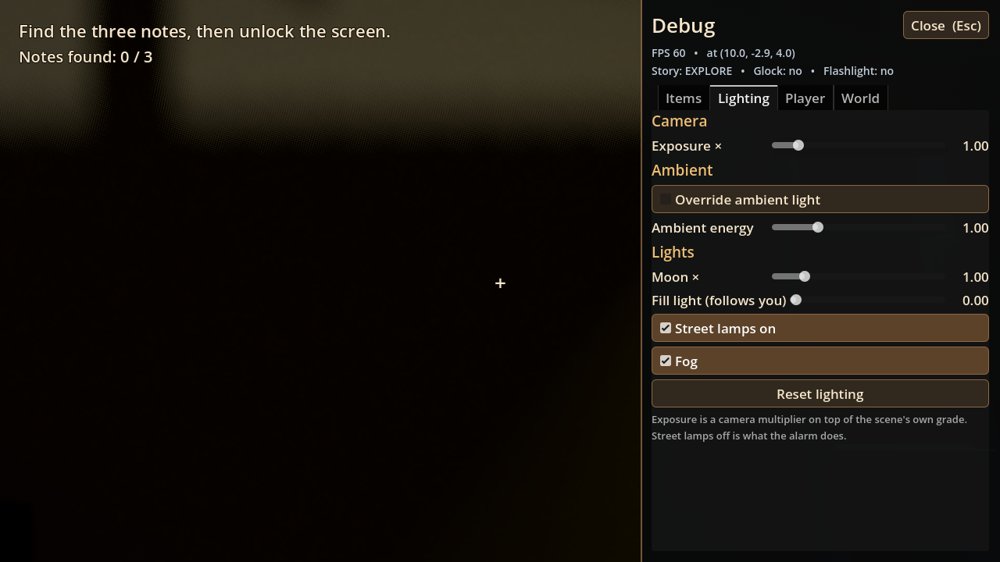
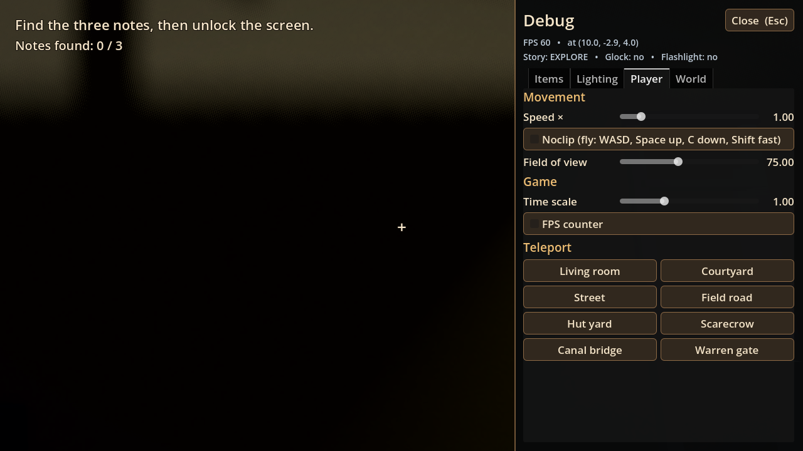
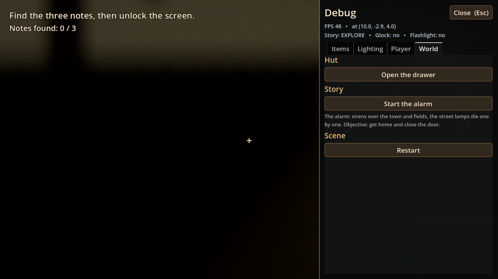
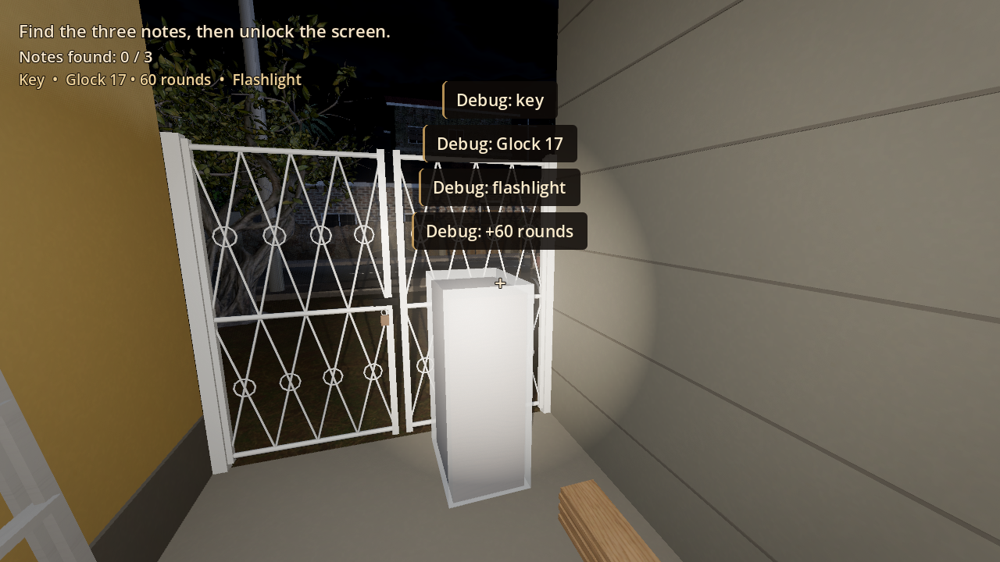

# Debug menu — Windows 0.20.0

**Open it:** while playing, type **Q W E R T Y** in order, with each key within 2 s of the last. A wrong key resets the
sequence. **Close it:** Esc, the Close button, or Q W E R T Y again. The world keeps running behind the panel, so
lighting changes show live. The player stands still and the mouse is free until the menu closes. It will not open over
the main or pause menu, the Glock inspect screen or dialogue. On the way, the keys still do their normal jobs: W steps,
E uses, R reloads and Q changes the TV channel. There is no way to open it on Android (no keyboard).

## Tabs
- **Items:** Give Glock, Draw / holster; bullets +17 / +60 / +200 (to the reserve), Fill magazine (17 + 1), Infinite
  ammo; Give flashlight, On / off, Brightness ×, Reach (m), Cone (°); Give hut key, Give everything. Items given here
  skip their hut scenes: the Glock does not start the hooded man's call-out.
- **Lighting:** Exposure × (a `CameraAttributesPractical` multiplier on the player camera), Override ambient light +
  Ambient energy, Moon × (Moon and SkyFill), Fill light (an omni light that follows the camera), Street lamps on,
  Fog, Reset lighting.
- **Player:** Speed ×, Noclip (fly: WASD along the view, Space up, C down, Shift fast), Field of view, Time scale, FPS
  counter; teleports: Living room, Courtyard, Street, Field road, Hut yard, Scarecrow, Canal bridge, Warren gate (a ray
  drops you onto the floor).
- **World:** Open the drawer, Start the alarm, Restart.
- The header shows FPS, position, story phase, Glock rounds (loaded + reserve) and the flashlight state.

## Files
- `game/scripts/debug_menu.gd` (new, `InteriorDebugMenu`, a CanvasLayer on layer 50, added by `interior.gd`).
- `player.gd`: `debug_speed`, `noclip` and `_fly()`. `gun.gd`: `infinite_ammo`, `debug_fill()`.
  `flashlight.gd`: `energy_scale`. `story.gd`: `debug_give_key/gun/flashlight()`. `hut_house.gd`: `remove_flashlight()`.
- Fix: opening the drawer after the debug menu had already taken the Glock or flashlight touched freed nodes. Those nodes
  are now checked first.
- `interior.gd`: `-- --capture-review --capture-views=debug` saves the four tabs and a shot with items, the flashlight
  and the fill light.

## Verification
- `tests/debug_menu_integration.gd` 36/36 (the sequence and its failures, Esc not opening pause, every item, each
  lighting control, speed, teleports onto the floor, noclip up and gravity after it, the drawer, the alarm, infinite ammo
  after 5 shots).
- Regression: `hut_story_integration` 74/74, `gun_integration` 41/41, `movement_stress` passed, `touch_integration`
  (`--mobile-test`) 29/29.
- EXE `builds/windows/Interior.exe` 0.20.0, 669,894,072 bytes, SHA-256
  `9985251c9a032f6f49282f8bb3de9845ad06d70ec5385a2237eaf829ca099fe6`. Its own `--capture-views=debug` run
  produced the images below with no script errors. The Android APK was not rebuilt.

## Screenshots sent
| File | What |
|---|---|
| `debug-1-items.png` | Items tab |
| `debug-2-lighting.png` | Lighting tab |
| `debug-3-player.png` | Player tab |
| `debug-5-items-and-fill.png` | After Give everything: the inventory, the flashlight and the fill light in the courtyard |

   

