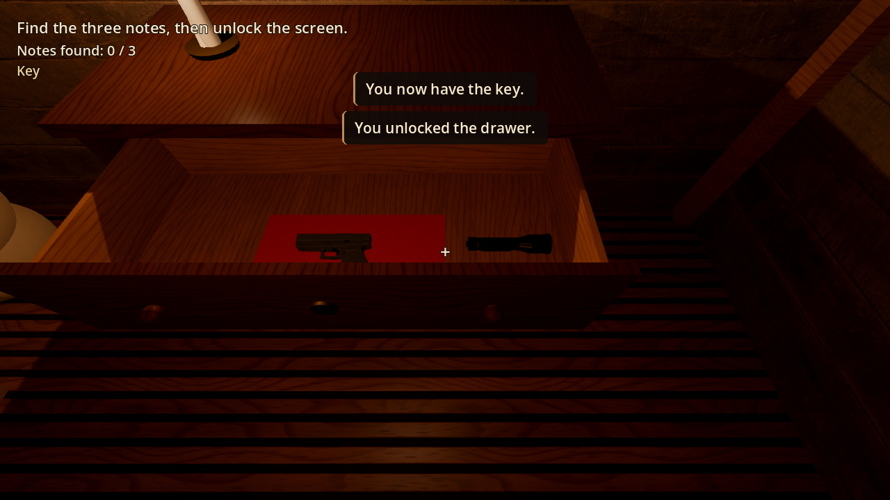
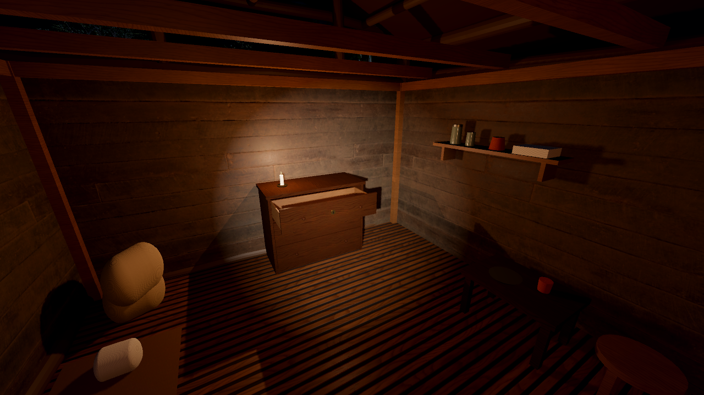
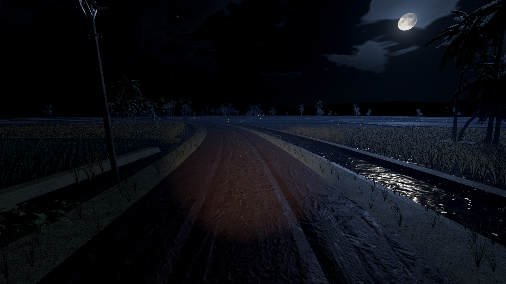

# Flashlight — Windows 0.19.0

The hut dresser's top drawer now holds a working flashlight next to the Glock 17.

## What the player gets
- When the drawer opens, a black aluminium flashlight lies on the tray beside the red cloth. E / Hold on it says
  "Pick up the flashlight". Taking it shows "You took the flashlight. Press L to switch it on." (mobile: "Tap Light…")
  and adds "Flashlight" to the inventory line. It can be taken before or after the Glock; aiming at the open drawer
  front offers the Glock first, then the flashlight.
- **L** switches it on and off (mobile: a **Light** button above Gun that appears once it is owned). Switching it plays a
  tail-switch click (generated at runtime) and the beam catches with a short stutter.
- The beam is a SpotLight3D (energy 9, range 30 m, 28° cone, attenuation 0.85, angle falloff 1.6) held a little left of and
  below the eye. It aims at the point 8 m ahead of the crosshair and trails fast turns slightly. Shadows are on outside
  Compatibility, and it lights both the indoor and outdoor layers. It works alongside the drawn Glock, and the gun view model
  gets a little of its light.

## Files
- `game/scripts/flashlight.gd` (new, `InteriorFlashlight`): the beam, the toggle, the click and `make_model()` (the
  primitive model: tail switch, knurled body, pocket clip, flared head, bezel, reflector and lens).
- `hut_house.gd`: the model and its `FlashlightUse/FlashlightBody` usable in `Dresser/TopDrawer`; `flashlight_picked` signal.
- `story.gd`: owns `flashlight`; `has_flashlight`; inventory; notification.
- `interior.gd`: `flashlight` action (L), help text, touch wiring; hut capture adds `hut-4b`, `hut-9` and `hut-10`.
- `mobile_controls.gd`: `light_pressed`, `set_light_state()`; the Light button is appended last, so the other
  buttons keep their indices.
- `gun.gd`: view-model key light brightens while the flashlight is on.

## Gotchas
- A `light_projector` texture on the SpotLight3D removed the light entirely in Forward+ (verified with an A/B test), so the
  hot spot comes from angle falloff instead.
- The `--capture-views=hut` capture was rendering black 3D since at least 0.18. Freezing the player as soon as play
  started left the view black. The capture now waits 1 s after `_play()`.

## Verification
- `hut_story_integration` 74/74, including 12 flashlight checks: in the drawer, prompt, pickup, notification,
  inventory, gone from the drawer, L on (energy 9), cull mask, beam at the eye and on the crosshair, L off.
- `gun_integration` 41/41; `touch_integration -- --mobile-test` 29/29 (now 10 buttons: 7 shown + Gun, Reload, Light hidden).
- EXE `builds/windows/Interior.exe` 0.19.0, 669,879,696 bytes, SHA-256
  `6ac8ec5fc22ea02c74c6a60fdb88fe7445aae45c9414155fa993e93153be0387`. Its own capture (`work/v19/exe-hut/`) shows the
  drawer, room and road views below with no script errors. The Android APK was not rebuilt.

## Screenshots sent
| File | What |
|---|---|
| `flashlight-1-drawer.png` | The Glock on the cloth, the flashlight beside it (EXE capture) |
| `flashlight-3-road.png` | The beam on the dirt road at night (sent mid-run from source, then confirmed in the EXE) |

