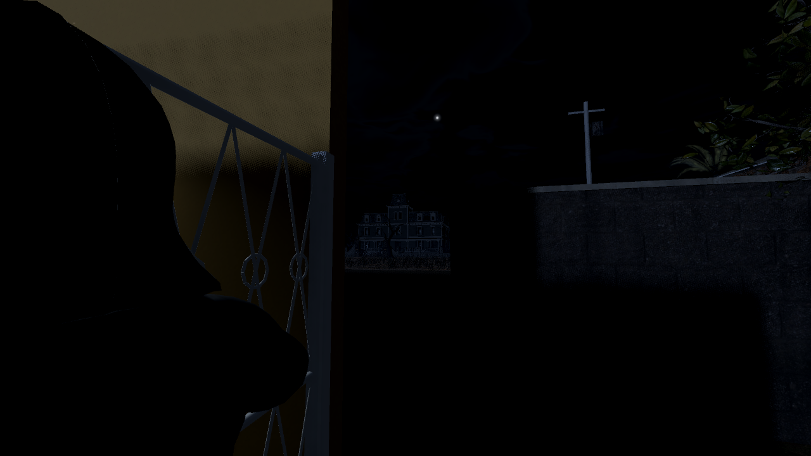
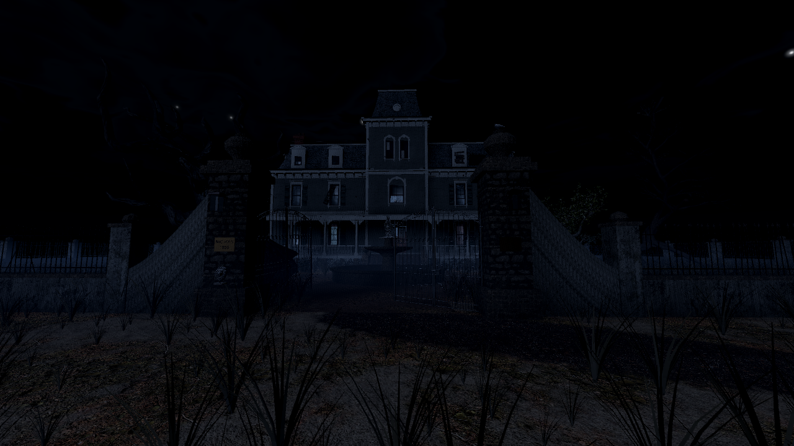
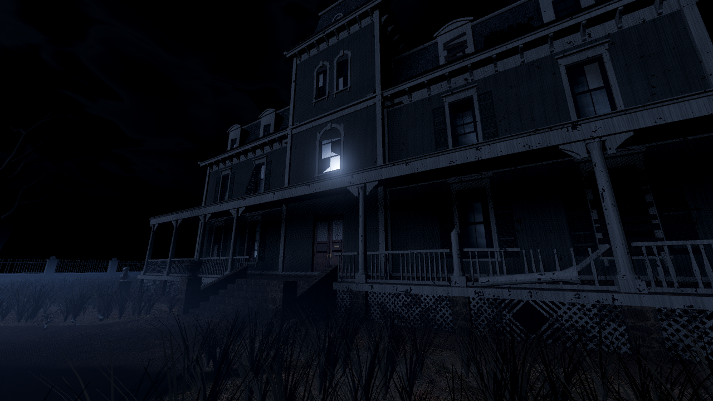
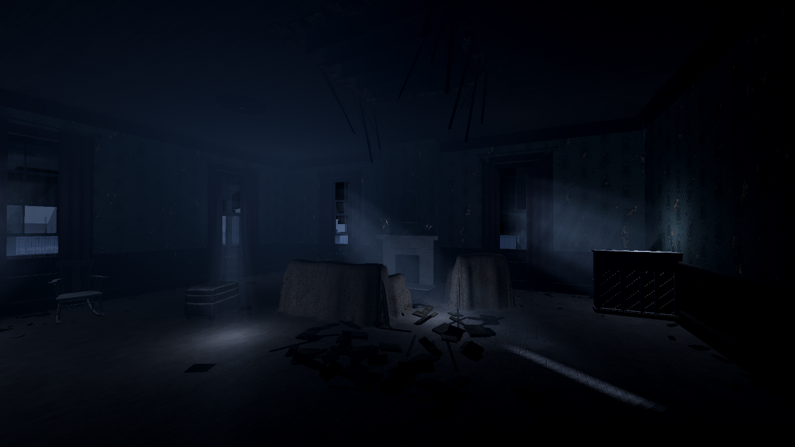
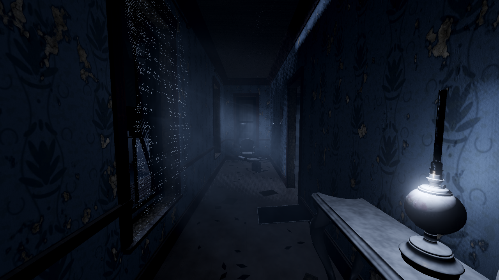
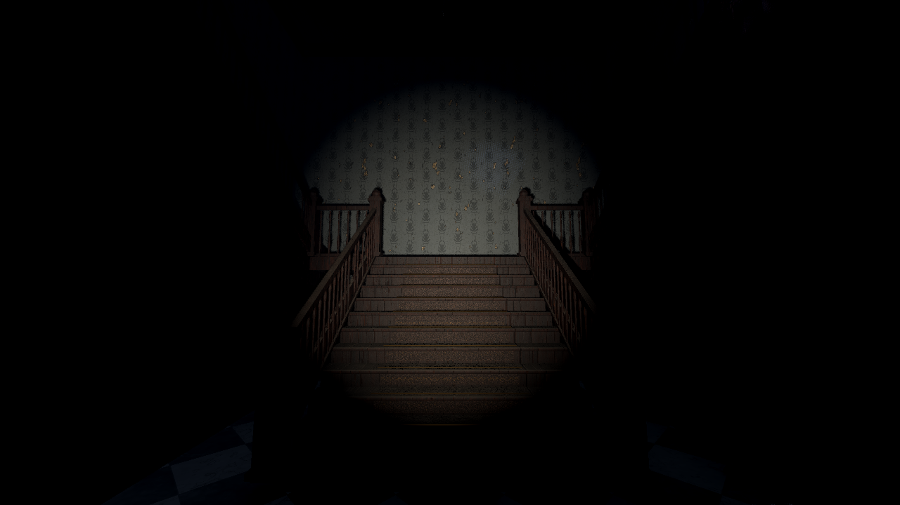
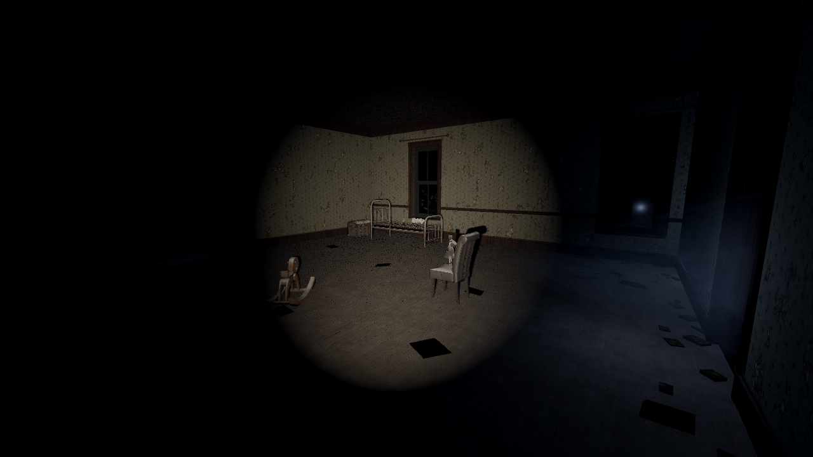

# The Nichols property — Windows 0.21.0

Updated 2026-10-09. The owner asked for:

- a really big old house, the way their arrow pointed when you first step out of the courtyard gate;
- at a distance, a dirt path to an open big gate, then the house;
- an interior after their references: an abandoned old house, dark, with only a little moonlight;
- no light source anywhere on the property "until later";
- the first time through the gate, the line "I've never been inside of the Nichols property..";
- an unlocked front door you push open or pull shut, with very old door sounds;
- loud echoing footsteps inside;
- open windows letting moonlight in;
- downloaded textures and custom 3D models, then the build.

## Where it is

- **From the courtyard gate.** Step out of the gate and look south-west, past the lot wall. The house stands across a dead field, about 95 m away, lit only by the moon (`from-the-courtyard-gate.png`).
- **Getting there.**
  - Walk south down street B. The middle sawhorses of its south barricade have been dragged aside; one lies on its side by the kerb.
  - Where the asphalt ends (z −40), a dirt path with wheel ruts crosses the field to the estate.
- **The estate** (x −40…14, z −60…−124) has:
  - a rendered boundary wall with iron railings (some pickets bent or missing);
  - two stone gate pillars with urn finials and dead lanterns; the left one carries a brass "NICHOLS 1906" plaque;
  - curved wing walls;
  - a tall double wrought-iron gate standing open, its left leaf sagging;
  - a gravel drive round a dry fountain with a weathered statue;
  - waist-high dead grass, 16 dead trees, stumps and roots, a marble bust and a cat statue lost in the weeds;
  - crows on the gate pillar and the porch roof;
  - faint mist in the grass (desktop High and Ultra).

The house is an American-era (1906) Second Empire mansion. American families built houses like it in Davao in the abacá years, which keeps it plausible for the setting.

## The house (custom models: `tools/blender/nichols/`)

**Outside**
- Stone plinth, weathered clapboard under flaking paint, corner boards and belt course.
- Bracketed cornice; a bell-cast slate mansard roof with 19 dormers (some boarded) and a torn patch of missing slates over bare battens; iron cresting.
- A central tower with paired arched windows, its own bracketed cornice, a bell-cast cap with oculi, cresting and an iron finial.
- Two brick chimneys with clay pots; gutters, one torn downpipe.
- The wrap porch:
  - turned columns (one snapped, its shaft lying on the boards) and a smashed railing bay;
  - a lattice skirt, gaps in the boards, haint-blue beadboard ceiling;
  - a porch swing hanging from one chain;
  - steps with stone cheeks, one urn still on its pedestal and the other knocked into the weeds.
- Sash windows have broken panes, louvred shutters (open, missing, half shut, hanging off one hinge) and pedimented or arched hoods. Some are boarded.

**Inside**
- **Ground floor:**
  - The foyer has a checkerboard marble floor and an imperial staircase: a centre flight to a half landing, then two return flights to side galleries and a bridge over the front door. The balustrades have turned balusters and newel posts, and a carpet runner with brass rods covers the stairs.
  - The parlour opens through a columned opening with pedestals and an entablature (the owner's 3rd reference). Its ceiling has fallen in: joists, hanging laths, a rubble pile below.
  - A dining room behind a half-drawn pocket door, where the chandelier has come down onto the table.
  - A rear hall, a library, a locked pantry and a kitchen.
- **Upper floor:**
  - The north corridor has moonlit windows and peeling blue damask (the owner's 2nd reference).
  - A master bedroom and a nursery.
- **Surfaces:**
  - Generated Victorian wallpaper (damask, sprigs, stripes) on stained paper, with water stains and tide lines, mildew at the skirting, and sheets peeled to cracked plaster.
  - Dark panelled wainscot with chair rail, skirting and crown mouldings.
  - Dusty boards; fireplaces with marble surrounds.
- **Cloth and debris:**
  - Tattered wine drapes and torn lace on brass rods; the lace's holes break up the moonlight on the floor.
  - Dust sheets over the sofa, an armchair, the library chair and the wardrobe.
  - Cobwebs in the corners; fallen plaster, papers, and leaves blown in under the broken windows.
- **Furniture and props:** 50+ downloaded pieces, darkened and dusted at runtime. They include:
  - the rocking chair at the parlour window, which rocks by itself;
  - a wheelchair in the dark nook under the landing;
  - a porcelain doll sitting under the moonlit hall window, and another doll on a chair facing the nursery door;
  - an iron cot and a rocking horse in the nursery;
  - a grandfather clock, crutches against the hall wall, a dusty piano and a chess game.

## Gameplay

- **First time through the gate:** "I've never been inside of the Nichols property.." (`ENTRY_LINE`, once per session).
- **Front door:** a heavy double door, unlocked, its left leaf standing a hand's width open.
  - E pushes it; hold E to grab a leaf and pull it.
  - Recorded hinge squeals play as it starts and while it is dragged, and it knocks shut with a thud (Gravity Sound, CC BY 4.0).
- **Interior doors:** some ajar, some shut, all creaking. The pantry door is locked: the handle rattles and the player remarks on it.
- **Echo:** inside, the footsteps bus is 3.5 dB louder, with a long hall reverb (wet 0.38) and a hard 125 ms / 290 ms slapback (`night_audio.gd`, `_mansion`). The night outside is muffled but still heard through the broken windows.
- **Light:** nothing on the property is lit.
  - The moon shines through the north and west windows as soft, dusty shafts, and pools faintly around where it lands.
  - The east rooms (dining, nursery, kitchen) are black without the flashlight.
- **Debug menu:** new teleports "Nichols gate", "Nichols foyer", "Nichols upstairs" and "Nichols parlour".

## How it works

- `tools/blender/nichols/build_nichols.py` (with `nichols_geo`, `nichols_plan`, `nichols_exterior`, `nichols_cloth`) writes `game/assets/models/nichols/house/`:
  - `house_ext`, `house_int`, `house_glass`, `house_cloth`, `house_void`;
  - two door leaves and six dust-sheet shapes;
  - `layout.json`: 286 collision boxes in Godot house-local space, door hinges, 40 windows, rooms and spots.
- `game/scripts/nichols_property.gd`, built by `neighborhood.gd` after the canal, does the rest:
  - places the house at (−12, −1.7, −82), front facing +Z;
  - binds the materials;
  - adds the doors, the gate, walls, terrain, grass, furniture and debris;
  - opens street B and adds bounds for the walkable south region (x −46…26, z −130…−18).
- **Shaders:**
  - `nichols_surface` handles flaking paint, grime, streaks, rising damp and dust.
  - `nichols_wallpaper`, `nichols_marble` and `nichols_ground` (path and gravel mask) do what their names say.
  - `nichols_beam` draws the moonbeams.
- **Lighting (the important part):**
  - The inside is on visual layer 11 (1<<10). The living room's shadowless "Key" directional light and the sky fill are masked off it at runtime.
  - A dedicated "Moon through the windows" directional light lights the inside. The shell casts its shadows through a shadow-only copy on layer 12.
  - Godot's volumetric fog ignored those window shadows (every room glowed), so the beams are soft additive card volumes. Each moonlit window's corners are ray-cast along the moon against a separate architecture-only physics layer (1<<19).
  - Each room has a reflection probe with a near-black ambient. Shadowless bounce lights sit where each beam lands and inside each moonlit window.
- **Outdoor checks:** six scripts decided "outdoors" with `y < −.4` and hid the whole town upstairs in the mansion. They now also accept `z < −17`: `balcony.gd`, `neighborhood.gd`, `atmosphere.gd`, `atmosphere_particles.gd`, `gun.gd` and `night_audio.gd`.
- **Assets:** `tools/assets/fetch_nichols.py` downloads them; `process_downloads.py` converts them (`nh_*` entries); `tools/assets/make_nichols_wallpaper.py` generates the wallpaper. Credits are in `game/licenses/THIRD_PARTY_MODELS.md` (Nichols section) and `game/licenses/NICHOLS_SOUNDS.md`.

## Verification

- **`tests/nichols_integration.gd`:** 46/46 headless, 48/48 windowed (the echo checks need audio). A real player walks the whole route:
  - courtyard gate → street B → through the barricade → the dirt path → the gate (where the line plays);
  - round the fountain → up the porch steps → the double door pushed open → the marble foyer;
  - up the centre flight, across the landing and up the west return flight → the gallery and the bridge → the corridor → the master bedroom.
  - It also checks the bridge balustrade, a locked door, floor heights, footstep surfaces (marble, wood), the echo zone and the 15 moonbeams.
- **Regressions** (all pass):

  | Test | Result |
  |---|---|
  | balcony | 63/63 (two checks now state the real invariant: town lights and meshes stay on the outdoor layer; the house's inside layers never touch the room's layer 1; the room's lights never reach the house) |
  | debug menu | 36/36 |
  | street | 27/27 |
  | canal | 57/57 |
  | warren | 87/87 |
  | hut story | 74/74 |
  | gun | 41/41 |
  | stranger | 26/26 |
  | neighbourhood interactions | 29/29 |
  | night revision | 28/28 |
  | fields | 25/25 |

- **Rendered review:** `tests/nichols_review.gd` (Forward+ High, 1600×900, RTX 4060). Every view held 60 FPS with vsync on. The busiest view, the parlour, draws about 2,600 calls and about 17 M primitives including shadows.
- **Exported EXE:** `builds/windows/Interior.exe` 0.21.0, 1,212,453,744 bytes, SHA-256 `0b405ea818788d025abe783b7531232cb18dfcd96a127cd8a8152177b699cd10`.
  - Its own `-- --capture-review --capture-views=nichols` produced the `nichols-*.png` images here with no script errors.
  - It reported: 15 beams, 9 doors, 109 models, 16,217 grass clumps, 323 colliders.

## Independent review (lemondev)

Two blind A/B passes ran: a fresh reviewer saw only the owner's four references and the EXE frames under random labels.

- **Pass 1:** the references won all four pairs. The main gap was that the moonlit surfaces were unreadable. The fix was moon bounce lights and a much thinner interior haze, which gave the corridor and parlour images above.
- **Pass 2:** the references still won all four. The room pair repeated the same gap: surfaces hard to make out compared with a brighter showcase render.
- **State: STOPPED — PLATEAU** against the reference images, by the skill's two-identical-gaps rule.
  - Part of the gap is the owner's darkness requirement against brighter showcase art. Part is real: the gate and exterior lack the references' fog-wrapped sky and stone staining.
  - After the stop: stone-block pillars, ground mist and more debris were added, but not re-reviewed.
- **Smallest next actions:** stained, eroded stone and rust on the gate and piers; a moonlit cloud layer behind the house; more structural damage indoors (cracked plaster, broken boards).

## Known gaps

- The EXE grew from 670 MB to 1.21 GB. Most of the increase is the downloaded furniture's textures, imported in two GPU formats. Downscaling small props to 512 px would recover a lot.
- The Android APK was not rebuilt. Compatibility gets no beams' depth fade, no volumetric mist, and only partial probe support.
- From some angles a moonbeam still reads as a slightly hard-edged wedge.
- The lace looks speckled up close.
- The tower and the upstairs back rooms are sealed (dark windows). "Until later": no light sources exist on the property yet, as asked.
- Three Commons sounds (wind howl, gate clasp, handle creak) were rate-limited or unreadable and are not used.

## Screenshots sent

| File | What |
|---|---|
| work map / `00-gate-south` | Site choice: the empty ground south of the town |
| `blender-foyer.png`, `blender-plan.png`, `blender-front.png`, `blender-back.png` | Clay renders of the house model |
| `r5` gate / drive / parlour / corridor | First in-game renders |
| `torch-sheet.jpg` | Inside by flashlight |
| `from-the-courtyard-gate.png` | The view the owner's arrow pointed to |
| `exe-captures.jpg` (`nichols-1…7`) | From the exported EXE |
| corridor and parlour after the lighting fix | Moon bounce, peeling damask |

  
  


Rebuild everything:

```text
python tools/assets/fetch_nichols.py
python tools/assets/make_nichols_wallpaper.py
"C:/Program Files/Blender Foundation/Blender 5.2/blender.exe" -b --factory-startup -P tools/blender/process_downloads.py -- nh_...
"C:/Program Files/Blender Foundation/Blender 5.2/blender.exe" -b --factory-startup -P tools/blender/nichols/build_nichols.py [-- --preview <dir>]
Godot_v4.7.2-stable_win64_console.exe --headless --path game --import
Godot_v4.7.2-stable_win64_console.exe --headless --fixed-fps 60 --path game --script res://tests/nichols_integration.gd
Godot_v4.7.2-stable_win64_console.exe --headless --path game --export-release "Windows Desktop" <abs>/builds/windows/Interior.exe
Interior.exe -- --capture-review --capture-views=nichols --capture-path=<dir>
```
