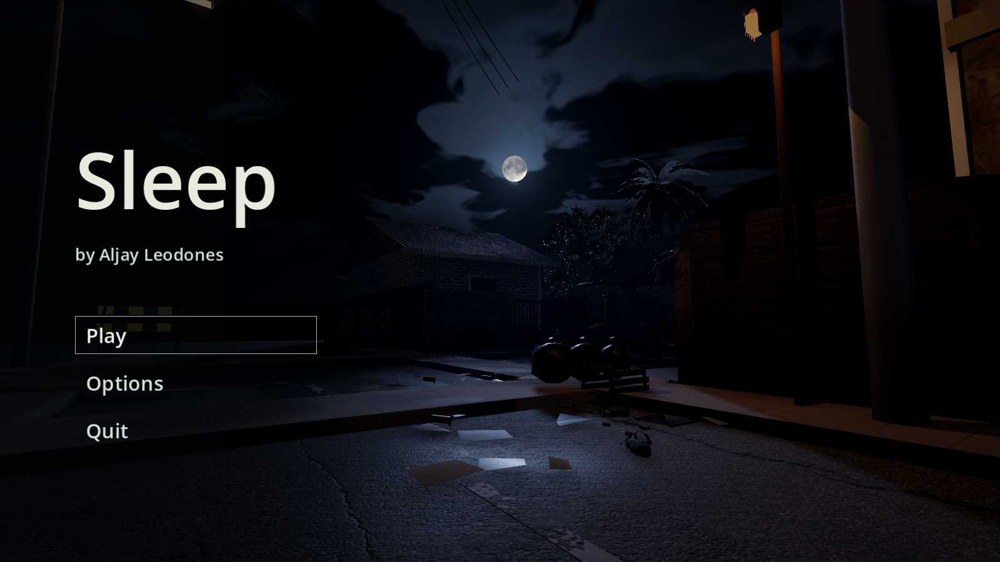
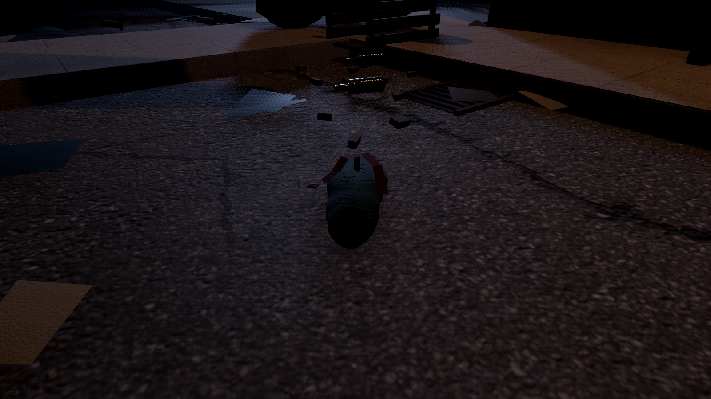
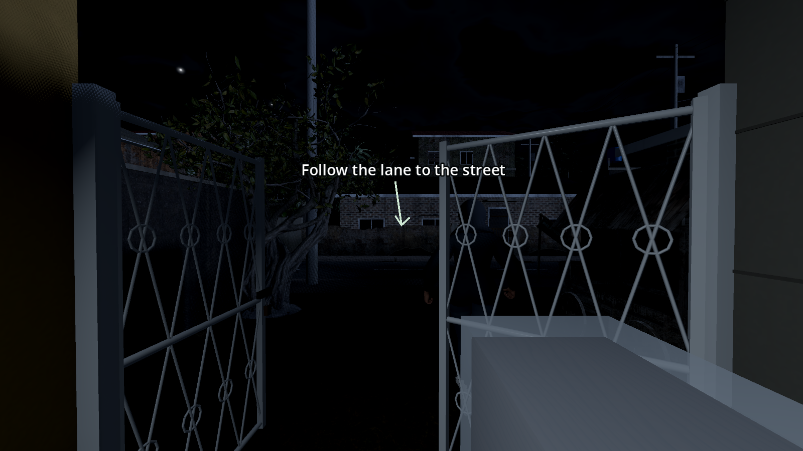
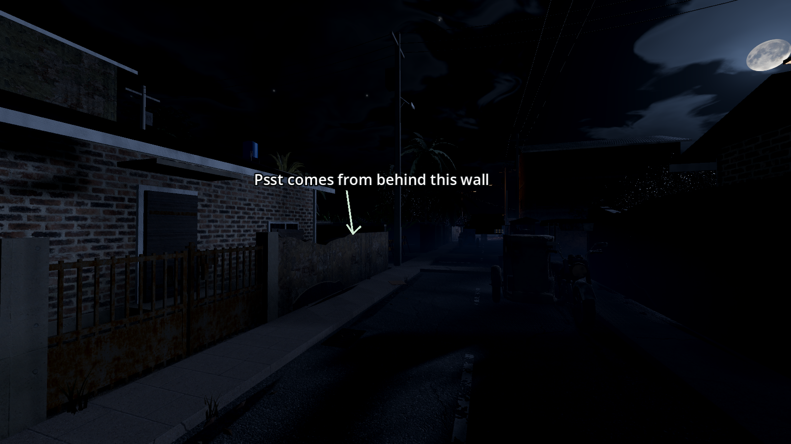

# Sleep — menu and audio update

Windows build: `builds/windows/Interior.exe` (version 0.15.0).

The title screen is a live Godot Camera3D in the existing playable neighborhood. Clouds, atmospheric particles, streetlamp flicker and a small camera drift run while the menu is open. Player movement, the stranger and story encounters wait for Play. Camera motion Off disables the camera drift. Play restores the room camera and indoor lighting; Pause stops gameplay normally.

Only **Sleep**, **by Aljay Leodones**, **Play**, **Options** and **Quit** appear on the title screen. Options contains graphics quality, camera motion and controls, and is also available from Pause.

The street detail is real 3D geometry and remains in the neighborhood during play: one chipped rubber tsinelas with a torn Y strap and loose fibres, creased sachets, discarded bottles, crushed cans, crumpled rubbish sacks, a broken crate, drain bars, concrete chips, a caged lamp and sagging wires. Existing houses, palms, gates, road damage and moonlight surround it. The camera is near the north end of street B at `(22, -2.19, 43)`; the slipper is at `(19.98, -2.867, 44.70)`.

## Where to hear “psst”

1. Start a new game, leave the room through the navy door, and go downstairs to the white courtyard gate.
2. Open the gate and follow the short lane straight to the main street, near the bent Malasugue Street sign.
3. Turn left along the street. The whisper triggers within the first few steps, from behind the wall beside the rusty gate on your left. It plays once per playthrough; Restart resets it. If story dialogue is still active, let it finish while you remain near the corner.

The arrows below are screenshot annotations for this guide; they are not shown during play.

The approach covers world X `18–24`, Z `5.5–16.5` at street level. The sound source is `(23.4, -1.45, 10.5)`. It now has its own audio player, a wider trigger covering both pavements, a stronger level, and less distance filtering. Distant footsteps cannot replace the whisper. Indoor return and active story dialogue suppress incidental scares.

## Footsteps

Player footsteps now retain their randomizer between consecutive steps on the same surface, preserving overlapping tails and sample variation. Their level is raised by 3 dB. They still follow actual movement, sprinting, crouching and surface type, including when camera motion is Off.

The unseen footsteps behind the player have a larger audible range, less low-pass filtering and a stronger source level. They remain positional and stop when you look toward them. They occur at the other neighborhood crossings and at occasional intervals outdoors.

## Verification

The rendered `game/tests/sleep_review.gd` checks live camera and street-light animation, title contents, layout, Options navigation, return to the room, pause behavior, motion Off, real walking input, automatic psst activation and distant-step playback/cancellation. Audio is recorded from the actual mixer into PCM WAV files, not inferred from a play() call. Results and peak levels are in `verification.json`.

- [Walking recording](walking-footsteps.wav)
- [Psst recording at the lane](psst-at-lane.wav)
- [Distant footsteps recording](distant-footsteps.wav)
- [Options screenshot](03-options.png)

Neighborhood interactions, movement stress, atmosphere integration and mobile-input regression tests pass. Native Windows export and an exported-build launch are checked separately in `export.log` and `windows-smoke.log`. Android has not been rebuilt for this update.

No generated background image is used or included. Geometry, existing project materials and Godot lighting produce the menu view.
